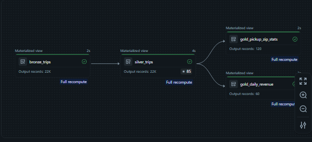
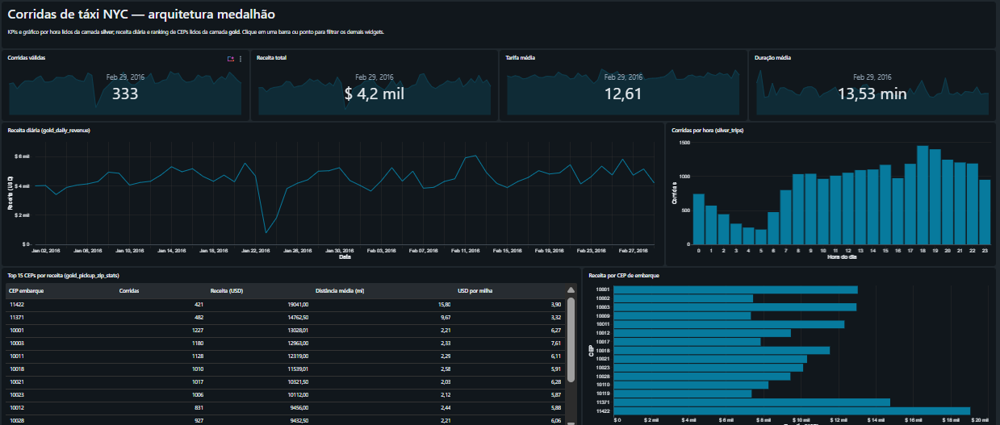

# Databricks Pilot: arquitetura medalhão de ponta a ponta

Projeto de engenharia de dados no Databricks que leva dados brutos até um dashboard
executivo, passando por três camadas de qualidade (bronze, silver e gold). Tudo é
definido como código e implantado com um único comando.

## Visão geral

```
samples.nyctaxi.trips ──► bronze_trips ──► silver_trips ──► gold_daily_revenue ──┐
      (fonte)              (cópia bruta)    (limpa e         gold_pickup_zip_stats ├──► Dashboard AI/BI
                                             validada)                             ┘
```

| Camada | Tabela | Papel |
|---|---|---|
| Bronze | `bronze_trips` | Cópia fiel da fonte com metadados de ingestão (`_ingested_at`, `_source`). |
| Silver | `silver_trips` | Tipagem, renomeação, colunas derivadas e regras de qualidade que descartam corridas inválidas. |
| Gold | `gold_daily_revenue`, `gold_pickup_zip_stats` | Agregações prontas para consumo: receita por dia e indicadores por CEP de embarque. |

Na última execução a silver descartou 85 das 21.932 corridas da bronze, por tarifa zero,
distância zero, horário invertido ou distância acima de 100 milhas.

## Stack

- **Declarative Automation Bundles (DABs):** o projeto inteiro é código, com targets `dev` e `prod`.
- **Lakeflow Declarative Pipelines:** transformações em Python com expectations de qualidade.
- **Unity Catalog:** governança, com catálogo e schema separados por ambiente.
- **Lakeflow Jobs:** execução diária do pipeline.
- **AI/BI Dashboards:** dashboard definido em JSON e implantado junto com o pipeline.
- **Compute serverless** para pipeline e SQL.
- **uv, ruff e pytest** no ambiente local.

## Estrutura do repositório

```
databricks.yml                      Definição do bundle, variáveis e targets dev/prod
resources/
  medallion.pipeline.yml            Pipeline bronze > silver > gold
  medallion_job.job.yml             Job diário que executa o pipeline
  medallion_dashboard.dashboard.yml Dashboard apontando para o schema do target
src/
  pipelines/medallion/transformations/
    01_bronze.py                    Ingestão bruta (com exemplo de Auto Loader comentado)
    02_silver.py                    Limpeza, tipagem e expectations
    03_gold.py                      Agregações de negócio
  dashboards/medallion.lvdash.json  Definição do dashboard AI/BI
  Databricks_Pilot/                 Código Python compartilhado
tests/                              Testes com Databricks Connect
```

## Regras de qualidade da silver

| Regra | Expressão | Ação |
|---|---|---|
| `valid_fare` | `fare_amount > 0` | descarta |
| `valid_distance` | `trip_distance > 0` | descarta |
| `valid_time_order` | `dropoff_at > pickup_at` | descarta |
| `reasonable_distance` | `trip_distance < 100` | descarta |
| `has_pickup_zip` | `pickup_zip IS NOT NULL` | registra |

Os resultados ficam visíveis na aba de qualidade de dados do pipeline, por execução.

## Como executar

Pré-requisitos: [Databricks CLI](https://docs.databricks.com/dev-tools/cli/install) e um
workspace com Unity Catalog e serverless. O [Databricks Free Edition](https://www.databricks.com/learn/free-edition)
atende.

```bash
# 1. Autenticar no workspace (ajuste o host em databricks.yml)
databricks auth login --host https://<seu-workspace>.cloud.databricks.com --profile FREE

# 2. Validar e implantar em dev
databricks bundle validate -t dev
databricks bundle deploy -t dev

# 3. Executar o pipeline
databricks bundle run -t dev medallion_pipeline

# 4. Ver os recursos criados (inclui a URL do dashboard)
databricks bundle summary -t dev
```

Em `dev` os recursos recebem o prefixo `[dev <usuário>]` e o agendamento fica pausado.
`databricks bundle deploy -t prod` publica no schema `prod` com o job diário ativo.

Para desenvolvimento local: `uv sync --dev`, depois `uv run ruff check .` e `uv run pytest`.

## Dashboard

O dashboard consome as camadas silver e gold:

- KPIs do último dia com tendência diária: corridas, receita, tarifa média e duração média.
- Receita diária (gold) e corridas por hora do dia (silver).
- Ranking dos 15 CEPs de embarque com maior receita (gold).





## Decisões de projeto

- **Materialized views em todas as camadas.** A fonte de demonstração é estática, então o
  recálculo completo é mais simples e barato. O bloco de Auto Loader em `01_bronze.py`
  mostra a migração para streaming tables quando arquivos passarem a chegar em um Volume.
- **Gold sempre derivada da silver, nunca da bronze.** Garante que todo consumo passe pelas
  regras de qualidade.
- **Dashboard sem catálogo fixo nas consultas.** O bundle injeta `dataset_catalog` e
  `dataset_schema`, então o mesmo JSON serve para dev e prod.

## Próximos passos

1. Trocar a fonte por dados reais chegando em um Volume, com Auto Loader e streaming tables.
2. Extrair a lógica da silver para funções puras e cobri-las com testes unitários.
3. CI/CD no GitHub Actions: validate, testes e deploy em prod a cada merge.
4. Notificações de falha no job e monitoramento das expectations.

## Autor

Marcelo Cardozo. Projeto desenvolvido como estudo prático de engenharia de dados no Databricks.
